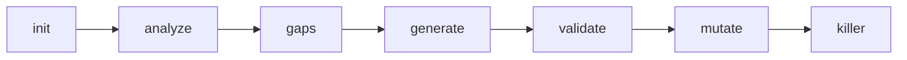

# Workflow

TestBoost follows a sequential workflow. Each step builds on the output of the previous one.



## 1. Init

**Command:** `python -m src.lib.cli init <project_path> [--tech <identifier>]`

Creates the `.testboost/` directory structure in your project and starts a new session.

**What it does:**
- Verifies the project path exists
- **Auto-detects** the project technology using the plugin registry (`pom.xml`/`build.gradle` → java-spring, `pyproject.toml`/`setup.py`/`setup.cfg` → python-pytest; Java wins when both are present)
- If `--tech <identifier>` is provided, uses that plugin directly instead of auto-detecting
- Prints a notice if multiple technologies are detected (e.g. both `pom.xml` and `pyproject.toml`)
- Creates `.testboost/config.yaml` with default settings
- Creates a numbered session directory (e.g. `001-test-generation/`)
- Writes `spec.md` with the session intent, progress table, and `technology` field
- Emits an HMAC-SHA256 integrity token

**Output:** `.testboost/sessions/001-test-generation/spec.md`

**Listing available plugins:** `python -m src.lib.cli --list-plugins`

## 2. Analyze

**Command:** `python -m src.lib.cli analyze <project_path>`

Scans the project to understand its structure, frameworks, and testing conventions.

**What it does:**
- Detects the project technology via `registry.detect()` (replaces hardcoded `pom.xml`/`build.gradle` checks)
- Parses build files for configuration and dependencies
- Detects frameworks (Spring Boot, JPA, pytest, etc.)
- Finds all testable source files via `plugin.find_source_files()`
- Detects existing test conventions using `plugin.test_file_pattern()` for test file discovery
- Builds a **full class index** for every source file (Java: fields with exact types, methods, annotations, hierarchy)
- Extracts representative test examples for LLM style reference

**Output:**
- `.testboost/analysis.md` -- project-level class index, test examples, conventions (shared across sessions)
- `.testboost/sessions/<id>/analysis.md` -- lightweight command overrides for this session

**Core functions used:**
- `analyze_project_context()` from `src/test_generation/analyze.py`
- `detect_test_conventions()` from `src/test_generation/conventions.py`
- `find_source_files()` from `src/lib/bridge.py` (routed through plugin)
- `build_class_index()` from `src/java/class_analyzer.py`
- `extract_test_examples()` from `src/java/class_analyzer.py`

## 3. Gaps

**Command:** `python -m src.lib.cli gaps <project_path>`

Identifies the source files that need tests.

- **`--coverage` (Java/Maven, recommended)**: runs the test suite with JaCoCo (no pom change) and
  reports as gaps the classes whose line coverage is below `--min-coverage` (80 by default), most
  missed lines first, with their uncovered lines and partially covered branches. `context` passes
  them on to the agent.
- **Default (file-level)**: a source file without a test file named after it — fast, needs no
  build, but blind to what tests really execute (on a module tested by feature it reported 11 % of
  classes tested for 93 % of lines covered).

**What it does:**
- Reads the source file list from the analysis step
- Uses the session's technology plugin: a source is covered when the test it
  would generate exists (`plugin.test_file_name()`), or when a test matching
  the plugin's globs is named after it (`FooTest`/`FooTests`/`TestFoo` for Java,
  `test_foo.py`/`foo_test.py` for Python). `analyze` uses the same rule for its
  *Has Test* column.
- Assigns priority: services and controllers are **high**, others are **medium**

**Output:** `.testboost/sessions/<id>/coverage-gaps.md`

## 4. Generate

**Command:** `python -m src.lib.cli generate <project_path> [--files file1 file2] [--agent]`

Generates unit tests for files identified as lacking coverage.

**What it does:**
- Reads the gap list and analysis conventions from previous steps
- For each source file, calls the LLM to generate a test class
- Uses the plugin's `prompt_template_dir` to load technology-specific prompts (Java prompts for Java projects, pytest prompts for Python projects)
- Passes project conventions (naming, assertions, mocking) to the LLM prompt
- Writes generated test files to the project
- Runs compile-and-fix loop: compiles tests, sends errors to LLM for fixing, within the `max_correction_retries` budget of `config.yaml` (default: 3 compile checks = up to 2 LLM fixes)
- Java: runs the compiled test once (`mvn test -Dtest=<Class>`) and lets the LLM fix runtime failures once (`--no-runtime-fix` to skip)

**Output:** `.testboost/sessions/<id>/generation.md` + test files on disk

**Core function used:**
- `generate_adaptive_tests()` from `src/test_generation/generate_unit.py`

The LLM prompt includes:
- Class information (name, type, package, methods, dependencies)
- **Full dependency signatures** from the class index (exact field types, all public methods)
- **Inheritance context** -- if the tested class extends another class in the index
- **Multiple test examples** from the project (up to 3 real files)
- Project conventions detected in the analysis step
- Technology-specific best practices (JUnit 5/Mockito for Java, pytest/unittest.mock for Python)
- Class-type-specific patterns (controller, service, repository)

### Agent mode (`context` + `generate --agent`)

Inside an LLM CLI the assistant is already an LLM: calling a second one through TestBoost needs
another API key and duplicates the work. In agent mode TestBoost never calls an LLM:

1. `context <project> [--files …]` writes, for each gap, a short brief to
   `sessions/<id>/agent/<SourceFile>.md` (plus `agent/manifest.json`) and prints the test path the
   plugin expects: what only TestBoost knows — the test stack actually available, the detected
   conventions, the exact dependency signatures from the class index, the parent class, the
   uncovered lines (`gaps --coverage`) and which project tests to imitate. The agent reads the class
   itself: the brief does not copy the source (about 25 lines instead of a 300–700-line prompt).
2. The agent writes each test at its expected path, and nowhere else.
3. `generate <project> --agent` registers them: missing tests and compilation errors (one
   `test-compile` for Maven, attributed per file; `py_compile` per file for Python) are reported and
   the step fails until they are fixed; otherwise `generation.md` is completed (`mode: agent`) and the
   integrity token is emitted. `validate` and `mutate` are unchanged.

`--files` (here and in `generate`) is matched against the gaps first, then against every source
file of the project — asking for a class that already has a test is how one strengthens it. A
pattern that matches nothing is an error, never a silent fallback to every gap.

The same cycle exists for mutation testing: `context --killer [--max-tests N]` writes one brief per
class with surviving mutants (`agent/killer/`: ids, lines, mutations), the agent writes the
`*KillerTest` files, and `killer --agent` registers and compiles them.

## Check (no session)

**Command:** `testboost check <project> [--base <git ref>] [--classes FQCN …] [--min-coverage 80]
[--min-mutation 80] [--no-mutation] [--target-tests …]`

Judges the tests, whoever wrote them. Runs the suite once under JaCoCo (failing tests are a
measure error: exit 2, before any mutation), then PIT, and compares both to their thresholds:
exit 0 when both are met, 1 when one is not, 2 when the measure failed.

With `--base`, only the lines changed since that ref count (`git diff --unified=0` plus untracked
files, main Java sources only): coverage of the changed *executable* lines (a line with a missed
branch counts as covered and is listed), PIT restricted to the changed classes, and the score
computed on the mutants of the changed lines. Declared equivalents (`testboost equivalent`, which
also accepts the ids of the last `check`) leave the denominator.

`--classes` judges only those classes (combinable with `--base`). `--target-tests` restricts both
JaCoCo and PIT to those test classes: how an agent measures the tests *it* wrote, alone.

**Output:** `.testboost/check/report.md` (the MR comment) and `.testboost/check/check.json`.

PIT needs `pitest-junit5-plugin` as a plugin dependency to run JUnit 5 tests, which only the pom
can declare: `testboost pit-setup <project>` adds `pitest-maven` and the plugin (pinned versions)
to the root pom's `<build><plugins>`. `mutate` and `check` refuse early, with that instruction,
instead of letting PIT find no test. The poms checked include the parents (`<relativePath>`, then
the local Maven repository): a module often inherits PIT from a parent outside its directory. Reports of every module are aggregated; reports older than
the run are ignored.

## 5. Validate

**Command:** `python -m src.lib.cli validate <project_path> [--full]`

Compiles and runs the generated tests using the plugin's build commands. Only the generated tests
run (Maven: `-Dtest=<their classes>`; Python: one run per file): this step checks what was
generated, and a module's whole suite can outlast `test_timeout_seconds`. `--full` runs the whole
suite, to check for regressions. The report records the scope (`generated` or `full`).

**What it does:**
1. Resolves the technology plugin for the current session
2. Runs `plugin.validation_command()` (e.g. `mvn test-compile` for Java, `py_compile` for Python)
3. If compilation fails, parses errors and presents them
4. If compilation succeeds, runs `plugin.test_run_command()` (e.g. `mvn test` for Java, `pytest` for Python)
5. Reports test results (passed/failed/skipped)

**Output:** `.testboost/sessions/<id>/validation.md`

## 6. Mutate

**Command:** `python -m src.lib.cli mutate <project_path> [--min-score 80] [--target-classes …] [--target-tests …]`

Runs PIT mutation testing to measure test quality (Java only). It requires a completed `validate`,
except with `--target-tests`: PIT then runs those tests green before mutating, which is the same
check.

**What it does:**
- Runs PIT mutation testing via Maven
- Analyzes mutation results: killed vs. surviving mutants
- Identifies hard-to-kill mutant patterns
- Provides priority improvement recommendations

**Output:** `.testboost/sessions/<id>/mutation.md`

### Equivalent mutants

Some survivors cannot be killed: the mutation changes the code but not its behaviour (sorting a list
that is always built in order, an early `return` of an already-empty list…). TestBoost never decides
that alone. The agent or a human declares it, with a reason:

```bash
python -m src.lib.cli equivalent <project_path> <mutant_id> --reason "why no test can observe it"
python -m src.lib.cli equivalent <project_path>                 # list the declarations
python -m src.lib.cli equivalent <project_path> <mutant_id> --remove
```

Mutant ids are shown in `mutation.md`. Declarations are project-level
(`.testboost/equivalents.json`, worth committing) and keyed on class, method, line, mutator and
description: when the code moves, the id changes and the mutant comes back as a survivor. The next
`mutate` reports the raw PIT score and an **effective score** without them (the threshold applies to
the effective score), and `killer` / `context --killer` no longer target them. In LLM mode, the killer
prompt lets the model flag a mutant with `// EQUIVALENT <id>: reason`; such suggestions are listed in
`killer-tests.md`, never applied.

## 7. Killer

**Command:** `python -m src.lib.cli killer <project_path> [--max-tests 10] [--agent]`

Generates targeted tests to kill surviving mutants.

**What it does:**
- Reads surviving mutants from the mutation step
- Generates killer tests via LLM (classes whose source can't be found, or with
  no usable LLM answer, are reported as skipped — never templated)
- Runs compile-and-fix loop on generated tests

**Output:** `.testboost/sessions/<id>/killer-tests.md` + test files on disk

## 8. Status (Auxiliary)

**Command:** `python -m src.lib.cli status <project_path>`

Displays the current session progress including the detected **technology** plugin. Shows which steps are completed, in progress, or pending.

## 9. Install (Setup)

**Command:** `python -m src.lib.cli install <project_path>`

Installs TestBoost slash commands and wrapper scripts into a target project so that you can run TestBoost from your project directory. See [Getting Started](./getting-started.md) for details.

## 10. Verify (Auxiliary)

**Command:** `python -m src.lib.cli verify <project_path> <token>`

Verifies an HMAC integrity token emitted at the end of a CLI step.

## HITL and Operations Commands

Five more commands support the asynchronous CI workflow (pause on
uncertainty, answer via MR comment, resume) and day-2 operations:

| Command | Purpose |
|---------|---------|
| `resume <project> [--answer-file f]` | Show the pending question, or resume a paused session with a signed answer |
| `sign-answer <project> --question-file q --answer-file a` | HMAC-sign a raw answer against a pending question |
| `gitlab post-question / fetch-answer <project>` | MR helpers used by the GitLab CI template |
| `cleanup <project> [--ttl-hours N] [--dry-run]` | Mark sessions stuck in `awaiting_input` past the TTL as abandoned |
| `doctor <project>` | Health checks: `.tb_secret`, write perms, Maven, LLM ping |

See [Async CI Integration](./ci-async-integration.md) and the
[GitLab Integration Guide](./gitlab-integration.md) for the full loop.

## Interactive Workflow with LLM CLI

When using TestBoost through an LLM CLI (Claude Code, OpenCode), the workflow becomes interactive:

1. The slash command tells the LLM what to do
2. The LLM runs the shell script and reads the output
3. The LLM presents the results to you in a readable format
4. You decide whether to proceed, adjust settings, or fix issues
5. The LLM suggests the next step

This interactive loop is particularly valuable at the **generate** and **validate** steps, where you can review generated tests, ask for modifications, and iterate on failures with the LLM's help.
